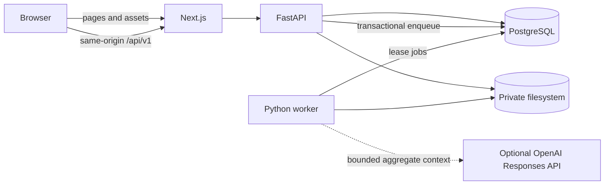
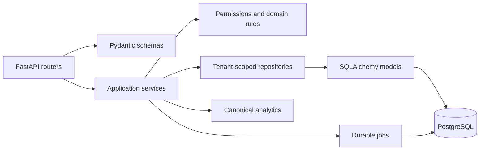
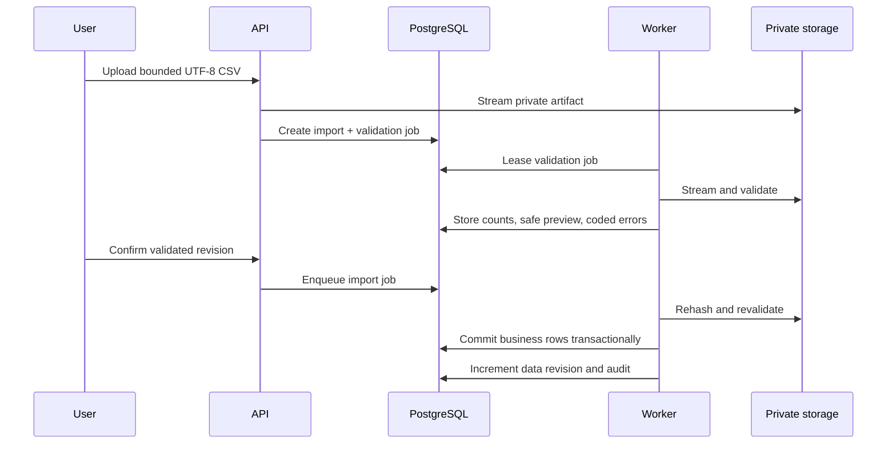

# InsightForge AI Architecture

## Status and goals

This document describes the implemented release-candidate architecture. The system prioritizes tenant isolation, reproducible analytics, safe AI behavior, durable background work, a credential-free demo, and straightforward container operation.

The first release is a modular monolith. A single Python package owns domain and persistence rules, while the HTTP API and background worker run as separate processes. This keeps transactions and authorization reviewable without coupling long-running jobs to request lifetimes.

## Runtime topology

Docker Compose runs PostgreSQL, a one-shot Alembic migration service, FastAPI, the worker, and the standalone Next.js server. The API and worker mount the same private artifact volume. Browser calls use `/api/v1` through the Next.js rewrite, keeping cookies and CSRF requests first-party.

## Web architecture

The web application uses Next.js App Router, React, TypeScript, Tailwind CSS, TanStack Query, Recharts, and local accessible UI primitives.

- Route groups separate marketing, authentication, and product layouts.
- Server Components load session/organization context and render static content where useful.
- Client Components handle charts, filters, forms, dialogs, uploads, and query/mutation state.
- URL search parameters own shareable range, search, sort, filter, and pagination state.
- TanStack Query owns server state; React state remains local and ephemeral.
- FastAPI remains authoritative for authorization, mutations, and analytics calculations.
- The browser API adapter has live and deterministic mock implementations. Production builds select the live adapter; Vitest/Playwright can select the mock without changing page code.
- Private route responses and API data are not placed in a public cache.

The responsive application shell uses a persistent desktop sidebar and accessible mobile navigation dialog. Charts include semantic names and tabular alternatives where the numbers need a non-visual representation.

## Backend modules

- `api/`: HTTP translation, dependencies, middleware, rate-limit calls, cookies, and response headers.
- `services/`: use-case orchestration and transaction boundaries.
- `repositories/`: persistence operations that always receive explicit organization context for tenant-owned data.
- `analytics/`: deterministic calculations and reporting-range rules.
- `imports/`: CSV templates, streaming parsing, typed validation, and safe normalization.
- `ai/`: deterministic generation, OpenAI Responses boundary, schema validation, and controlled question intents.
- `worker/`: handlers, lease lifecycle, retries, stale-job recovery, and cleanup.
- `storage/`: path-contained private filesystem reads/writes.

Routers do not contain business calculations. Services do not trust organization IDs from payloads. Provider-specific AI details do not enter the metric engine.

## Identity, sessions, and CSRF

Passwords use Argon2id. Successful registration or login creates an opaque random session token; only its SHA-256 digest is stored. Session records have idle and absolute expiry, revocation, safe browser metadata digests, and a demo flag.

The session cookie is HttpOnly and SameSite Lax. Production configuration requires Secure mode and uses the `__Host-` prefix. Unsafe requests require a double-submit CSRF token whose digest is bound to the active session; pre-authentication tokens are HMAC-signed and short-lived. Exact origin, host, and CORS allowlists are validated.

Password recovery uses purpose-bound, random, single-use action tokens stored only as hashes. A successful recovery changes the Argon2 password hash, consumes all active recovery tokens, and revokes every session for that user.

## Tenant isolation and authorization

The authenticated user and organization membership produce a `TenantContext`. Organization-owned API operations require `X-Organization-ID`; the server checks membership and the capability matrix before any repository call.

Isolation is layered:

1. route dependency validates session, membership, role, demo policy, and organization state;
2. services enforce operation-specific constraints;
3. repositories scope reads/writes by organization;
4. organization IDs are copied onto child records;
5. composite foreign keys and organization-scoped uniqueness prevent cross-tenant parent references;
6. cross-tenant lookups use concealed not-found responses;
7. job payloads persist the trusted organization/requester and revalidate them before final work.

Roles are Owner, Admin, and Member. Owner-only actions include billing and destructive organization operations. Admins can manage business data and Members where allowed. Final-owner invariants prevent accidental orphaning.

Demo Owner is a session policy layered over the Owner role. It can exercise controlled product workflows but cannot affect another organization, collect payment, or perform disallowed external/destructive actions. Demo organizations expire and are cleaned by worker jobs.

## Commerce and money model

Customers, products, orders, order items, and status events are normalized tenant-owned records. PostgreSQL fixed-precision numeric columns store money; order items snapshot product name, SKU, unit price, discount, and line total so historical orders do not change with the product catalog.

The service calculates order subtotal, discount, tax, and total. Explicit transition rules control pending, paid, processing, completed, cancelled, and refunded states. Mutable aggregates use version columns and `ETag`/`If-Match` to prevent silent lost updates.

## Canonical analytics

The analytics service resolves a requested range in the organization's time zone and converts it to UTC query boundaries. It returns current and comparison periods, granularity, currency, data availability, metric version, and source revision.

Core semantics include:

- eligible revenue comes from paid, processing, and completed orders;
- pending/cancelled/fully refunded orders contribute no revenue;
- average order value is eligible net revenue divided by eligible orders;
- customer acquisition follows `acquired_at` within the selected range;
- recurring revenue uses products/orders identified by the implemented recurring-revenue rules;
- division-by-zero and empty comparison periods produce explicit unavailable values rather than invented percentages.

Overview, detailed analytics, reports, deterministic insights, weekly summaries, and Ask Your Data all consume this same engine or its revisioned snapshot. There is no frontend copy of business math.

## CSV import workflow

The initial limits are 10 MiB and 50,000 data rows. The parser enforces UTF-8, exact versioned headers, column/field/error caps, typed dates/numbers/enums, references, and duplicate policy. Filenames and MIME types are advisory; content is inspected. Safe previews omit raw file access, and error excerpts are bounded. The final business write is all-or-nothing.

Artifacts live below a configured private root using opaque keys and path containment. Download/preview routes recheck current permission. Cleanup jobs delete retained content at expiry.

## Durable job system

PostgreSQL is the durable queue for the initial release. Commands create a resource row and `background_jobs` row in one transaction. Workers claim available rows with `FOR UPDATE SKIP LOCKED`, record `locked_by`/`locked_until`, and heartbeat long work.

Handlers cover demo data, import validation/commit, insights, weekly summaries, reports, data exports, demo expiration, deletion, and artifact cleanup. Retries are bounded and reserved for idempotent stages. Stale leases can be reclaimed; terminal errors retain safe codes and request IDs without secrets or raw rows.

This design avoids an external broker until measured throughput justifies it while still surviving API/worker restarts.

## AI and Ask Your Data

Deterministic AI is the default and complete credential-free mode. It produces typed findings from canonical metrics with fixed English templates and provenance.

The optional OpenAI provider receives a bounded schema of calculated aggregate findings, not raw customer/order rows or database credentials. Provider output is size-limited and schema-validated before persistence. Provider/model/prompt version and generation mode are recorded.

Ask Your Data does not ask a model to write SQL. A controlled classifier maps the question to implemented intents such as sales status, top product, revenue decline, top customers, or business summary. The service calls the corresponding analytics function and builds an answer with metric citations. Prompt-injection patterns, tenant-selection attempts, arbitrary query requests, and unsupported questions return controlled statuses.

## Reports and exports

Report creation stores an allowlisted template, range, format, requester, and source revision, then queues worker generation. CSV/JSON output is built from canonical analytics or tenant-scoped report queries. CSV cells that could be interpreted as spreadsheet formulas are neutralized.

Artifacts use opaque storage keys, content hashes, expiration, and authorization on every status/download request. A report ID or object key is never sufficient authority.

## Billing

Billing is an internal no-charge demonstration service. Plan definitions, usage limits, subscription state, demonstration invoice records, upgrade intents, and management intents are implemented. Simulated transitions are Owner-only, allowlisted, idempotent, and audited.

There is no payment SDK, checkout, card collection, external portal, or webhook route. Reserved provider columns/enum values in the schema are compatibility space, not an implemented integration.

## Error handling and observability

Middleware assigns/validates a request UUID and returns it in `X-Request-ID`. API errors use stable problem codes and safe English messages. Structured JSON logs include route templates, status, duration, request/job identifiers, and safe metadata.

Redaction rules exclude passwords, cookies, CSRF/session/action/invitation tokens, authorization headers, API keys, connection credentials, raw uploads, AI prompt bodies, and unnecessary personal data. Audit rows record actor, organization, action, resource, request ID, time, and bounded safe metadata.

Health endpoints distinguish process liveness, database/migration readiness, and build version. Worker state is observable through queue status, leases, attempts, progress, and safe terminal failures.

## Deployment boundary

The verified topology uses portable multi-stage images and Docker Compose. A hosted release must provide:

- HTTPS and same-origin `/api/v1` routing;
- separate staging/production secrets and databases;
- managed PostgreSQL with backups and tested restore;
- a shared persistent private filesystem for API/worker, or a newly implemented remote adapter;
- one controlled Alembic migration job;
- trusted proxy/host/origin configuration;
- logs, alerts, backup/rollback procedures, and a live smoke run.

PostgreSQL row-level security, remote object storage, transactional email, a payment provider, an external job broker, PDF reports, and enterprise identity are not claimed in this release candidate.
