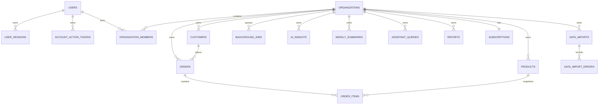

# InsightForge AI Data Model

## Principles

- PostgreSQL is the source of truth; Alembic owns every schema change.
- UUID primary keys are application-generated.
- Timestamps are timezone-aware UTC values.
- Organization-owned records carry non-null `organization_id` where applicable.
- Tenant-scoped unique and parent/child constraints include organization context.
- Stored money uses fixed-precision `NUMERIC`, never floating point.
- Soft deletion preserves commerce history where required.
- Versioned mutable resources support optimistic concurrency.
- Tokens and private object keys are never treated as user authority.

## Relationship overview

## Identity and tenancy

### `users`

Account email (`CITEXT`, unique), Argon2 password hash, display name, active/invited/disabled status, verification and login timestamps, locale, and time zone.

### `user_preferences`

One row per user containing weekly-summary, insight-alert, product-update, and compact-table preferences.

### `user_sessions`

Token/CSRF digests, idle and absolute expiry, activity/revocation times, optional IP/user-agent digests, and demo-session marker. Raw tokens never persist.

### `account_action_tokens`

Purpose-bound password-reset/email-verification/email-change token digest, optional pending email, expiry, consumption, attempts, and creation time. The release candidate uses password-reset tokens.

### `organizations`

Name, globally navigable slug, reporting currency, time zone, industry, active/suspended/pending-deletion status, onboarding state, data revision, creator, demo lifecycle, timestamps, and optimistic version.

### `organization_members`

Organization/user pair, Owner/Admin/Member role, join/removal times. Membership uniqueness and final-owner invariants are enforced by constraints/service transactions.

### `organization_invitations`

Organization, normalized invited email, role, hashed single-use token, inviter, expiry, acceptance/revocation, and creation time.

## Commerce

### `customers`

Organization, optional external ID, name/email/company, active/at-risk/inactive status, derived segment, acquisition/last-order times, fixed-precision lifetime value, soft deletion, timestamps, and version.

### `products`

Organization, optional external ID, organization-scoped SKU, name, category, unit price, active/inactive/archived status, soft deletion, timestamps, and version.

### `orders`

Organization, customer, optional external ID, organization-scoped order number, status, ordered time, fixed-precision subtotal/discount/tax/total, currency, source, timestamps, and version.

### `order_items`

Organization/order/product, immutable product-name and SKU snapshot, integer quantity, fixed-precision unit price/discount/line total, and creation time. Composite tenant references prevent cross-organization links.

### `order_status_events`

Append-style organization/order status history with actor, from/to status, safe reason, and occurrence time.

## Imports, jobs, and idempotency

### `data_imports`

Organization/requester, customer/product/order kind, workflow status, original filename, private storage key, SHA-256 digest, size, template version, field mapping, row counts, bounded validation summary, lifecycle timestamps, and expiry.

### `data_import_errors`

Organization/import, row/column, stable error code, safe English message, and bounded raw-value excerpt.

### `background_jobs`

Organization/requester, actor type, job type, bounded JSON payload/progress, queued/running/succeeded/failed/cancelled status, priority/run time, attempts, lease owner/expiry, optional idempotency record, trace ID, safe terminal error metadata, lifecycle timestamps, and timestamps/version mixins.

### `idempotency_records`

Non-null scope, actor, operation, UUID key, canonical request hash, processing/completed state, replay response metadata, resource link, expiry, timestamps, and uniqueness on scope/operation/key.

## Analytics and intelligence

### `metric_observations`

Organization, metric key, observation date, numeric value/unit, dimensions plus digest, optional source import, and creation time.

### `metric_snapshots`

Organization, cache/metric key, grain, period, bounded JSON payload, source revision, computation time, and expiry. Snapshots are derived caches; normalized commerce records remain authoritative.

### `ai_insights`

Organization, title/description/category/severity, supporting metrics, provider/model/prompt/generation provenance, active status, period, generation/expiry/supersession times.

### `weekly_summaries`

Organization/week identity, input metrics, structured summary, provider/model, generating user, and generation time. The organization/week pair is unique.

### `assistant_queries`

Organization/user, redacted question, controlled intent/parameters, answer/status, applied range, confidence, follow-ups, supporting metrics, provider, and creation time.

### `reports`

Organization/creator, report type/name/filters, queued/generating/ready/failed/expired status, CSV/JSON format, source revision, safe result summary, private storage key, generation/expiry, and timestamps.

## Billing and audit

### `subscriptions`

One row per organization with Free/Pro/Business plan, status, provider marker, reserved provider identifiers, current period, cancel-at-period-end, and timestamps. Only the `demo` service is implemented; a reserved `stripe` enum value is not an integration claim.

### `billing_events`

Organization/subscription, unique event identifier, type, canonical payload digest, processing status, and timestamps. The implemented rows record idempotent simulated transitions without payment data.

### `audit_logs`

Organization, actor user/type, action, resource type/ID, request ID, bounded safe metadata, occurrence time, and UUID. Passwords, tokens, raw CSV, private paths, provider bodies, and payment data are excluded.

## Deletion and retention

- User sessions and action tokens expire/revoke and can be cleaned after their security retention window.
- Demo organizations carry explicit expiry/status/generation and are removed through durable cleanup.
- Imports, report artifacts, and data exports have independent expiration; metadata/audit rows may outlive private objects.
- Customer/product soft deletion protects order history.
- Organization deletion uses a scheduled grace period and worker execution where policy permits it.
- Derived metric snapshots can be recomputed from authoritative commerce records.

The full column types, checks, foreign keys, indexes, and downgrade operations are defined in `apps/api/alembic/versions/20260810_0001_initial_schema.py` and mirrored by SQLAlchemy models.
