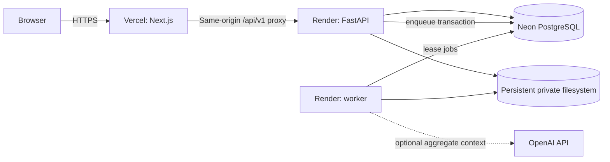

# InsightForge AI Deployment Guide

## Deployment status

The repository is designed to run as portable containers. The integrated Next.js, FastAPI, worker, PostgreSQL, migration, and persistent private-volume topology is verified locally with Docker Compose. No public provider or domain has been verified yet.

Vercel, Render, and Neon are illustrative hosting options in this guide, not runtime dependencies or evidence of a completed deployment. The selected API/worker host must provide a shared persistent private filesystem unless a separately implemented remote-storage adapter replaces it.

A public deployment is not considered verified until the final checklist in this document and the production smoke tests have passed against the actual URLs.

## Runtime topology



The API and worker use the same immutable image and revision. Only the worker claims durable jobs. Database migrations run once as a release/pre-deploy command, never concurrently in every API replica.

## Environments

Use separate projects, databases, buckets, credentials, origins, and provider settings for local development, staging, and production.

| Environment | Purpose                                         | Data policy                                                        |
| ----------- | ----------------------------------------------- | ------------------------------------------------------------------ |
| Local       | Development and automated tests                 | Deterministic fictional data only                                  |
| Staging     | Migration, integration, and release smoke tests | Resettable fictional data; no production secrets                   |
| Production  | Public portfolio evaluation                     | Isolated demo organizations and explicitly created user workspaces |

Do not clone real customer data into staging or the portfolio demo.

## Required services

- Node.js 24 or a supported Node.js release satisfying Next.js requirements.
- Python 3.11.
- PostgreSQL 17-compatible service with TLS in hosted environments.
- A persistent private storage adapter for CSV uploads and generated exports.
- Two application processes from the API image: HTTP API and durable worker.
- HTTPS at the public edge.

## Configuration contract

Start from `.env.example`. Set values through the hosting provider's secret manager; do not upload `.env` files.

### API and worker

| Variable                              |    Required | Purpose                                                      |
| ------------------------------------- | ----------: | ------------------------------------------------------------ |
| `INSIGHTFORGE_ENVIRONMENT`            |         Yes | `staging` or `production`; enables secure startup checks     |
| `DATABASE_URL`                        |         Yes | Async SQLAlchemy PostgreSQL URL with TLS requirements        |
| `INSIGHTFORGE_ALLOWED_HOSTS`          |         Yes | JSON list of accepted API/proxy host names                   |
| `INSIGHTFORGE_ALLOWED_ORIGINS`        |         Yes | Exact HTTPS browser origins; no wildcard                     |
| `INSIGHTFORGE_CSRF_ALLOWED_ORIGINS`   |         Yes | Exact HTTPS origins accepted for unsafe requests             |
| `INSIGHTFORGE_SESSION_COOKIE_SECURE`  |         Yes | Must be `true` outside local development                     |
| `INSIGHTFORGE_CSRF_SIGNING_KEY`       |         Yes | Unique high-entropy deployment secret                        |
| `INSIGHTFORGE_PRIVATE_STORAGE_PATH`   |         Yes | Persistent private artifact root shared by API and worker    |
| `INSIGHTFORGE_AI_PROVIDER`            |         Yes | `deterministic` by default or explicitly configured provider |
| `INSIGHTFORGE_OPENAI_API_KEY`         | Conditional | Required only for the OpenAI adapter; server-side secret     |
| `INSIGHTFORGE_OPENAI_MODEL`           | Conditional | Explicit approved model when OpenAI is enabled               |
| `INSIGHTFORGE_OPENAI_TIMEOUT_SECONDS` |          No | Bounded provider request timeout                             |

Production settings validation must reject insecure cookie mode, a development CSRF key, wildcard origins, unsupported providers, or missing conditional credentials.

### Web

| Variable                   | Required | Purpose                                                |
| -------------------------- | -------: | ------------------------------------------------------ |
| `API_INTERNAL_URL`         |      Yes | Server-side upstream used by the `/api/v1` proxy       |
| `NEXT_PUBLIC_API_BASE_URL` |      Yes | Browser-visible same-origin prefix; normally `/api/v1` |

Never expose database, OpenAI, or storage credentials through a `NEXT_PUBLIC_` variable. Billing has no external provider credentials in this release candidate.

## Local integrated deployment

```bash
cp .env.example .env
docker compose up --build
```

The stack exposes:

- Web: `http://localhost:3000`
- API: `http://localhost:8000`
- OpenAPI UI in development: `http://localhost:8000/api/docs`
- PostgreSQL: `localhost:5432`

Use `docker compose logs -f api worker web` for redacted service logs. Stop the stack with `docker compose down`. Add `--volumes` only when intentionally deleting all local database and private-storage data.

## Build artifacts

### Web

```bash
npm ci
npm run lint --workspace @insightforge/web
npm run typecheck --workspace @insightforge/web
npm run test --workspace @insightforge/web
npm run build --workspace @insightforge/web
```

### API

```bash
uv sync --project apps/api --all-groups --locked --no-editable
uv run --project apps/api --no-sync ruff check apps/api
uv run --project apps/api --no-sync mypy apps/api/src
uv run --project apps/api --no-sync pytest apps/api
uv build --project apps/api
```

Container builds must use committed lockfiles and record the Git commit identifier through build metadata.

## Database provisioning

1. Create separate database roles for migrations and runtime when the provider permits it.
2. Require TLS and verify the managed service certificate policy.
3. Grant the runtime role only required schema/table/sequence privileges; it is not an owner or superuser.
4. Set the pool size based on the provider connection limit divided across API and worker instances with operational headroom.
5. Enable provider backups and verify point-in-time recovery before public launch.
6. Run `alembic upgrade head` once through the release command.
7. Confirm `/health/ready` reports the expected migration revision.

### Migration policy

Prefer expand-and-contract migrations:

1. Add backwards-compatible tables/columns/indexes.
2. Deploy code that can read old and new shapes when a transition requires it.
3. Backfill through a bounded, observable job.
4. Switch reads and writes.
5. Remove obsolete schema only in a later release after rollback is no longer required.

Large indexes use the provider-supported online/concurrent mechanism where possible. Test migration time and locks against a staging dataset before production.

## Private storage

The implemented adapter requires a persistent private filesystem mounted at `INSIGHTFORGE_PRIVATE_STORAGE_PATH` and shared by the API and worker.

- Keep the root outside every public web directory and deny direct public serving.
- Mount only the intended application volume with environment-specific access.
- Encrypt the underlying disk and transport according to the host's controls.
- Preserve the application's opaque server-generated keys and path-containment checks.
- Route every preview and download through the API so current tenant authorization is rechecked.
- Back up retained artifacts only when the documented retention and privacy policy requires it.
- Keep the worker cleanup process active; it owns application-level expiration.

The adapter rejects path traversal after resolving the final path. A remote object-store adapter is optional future work and must not be configured merely by inventing environment variables.

## Illustrative web deployment on Vercel

1. Import the repository and set the application root to `apps/web` only if workspace installation remains rooted at the repository; otherwise keep the root at the repository and configure the web build command explicitly.
2. Install with `npm ci` from the committed root lockfile.
3. Build with `npm run build --workspace @insightforge/web`.
4. Configure `API_INTERNAL_URL` and `NEXT_PUBLIC_API_BASE_URL=/api/v1`.
5. Configure the Next.js rewrite/proxy so `/api/v1/:path*` reaches the Render API without changing the browser origin.
6. Preserve `Set-Cookie`, `Cookie`, `Origin`, `X-Request-ID`, `Idempotency-Key`, `If-Match`, and CSRF headers through the proxy.
7. Do not cache authenticated API responses at the edge; respect `private, no-store`.

Validate cookie Domain/Path/Secure/SameSite behavior in the deployed browser. Proxy route protection is an optimistic navigation guard only; FastAPI remains authoritative.

## Illustrative API and worker deployment on Render

Create one image-based service definition and two process types:

- API: `uvicorn insightforge.main:app --host 0.0.0.0 --port $PORT --proxy-headers --forwarded-allow-ips=<trusted proxies>`
- Worker: `python -m insightforge.worker`
- Release/pre-deploy: `alembic upgrade head`

Both runtime processes use the same database, shared persistent storage volume, build revision, and AI settings. Scale API replicas independently from worker concurrency. Keep at least one worker active while durable jobs are enabled.

Configure platform health checks:

- `/health/live` for process liveness.
- `/health/ready` for database/migration readiness.
- Worker process/heartbeat and expired-lease metrics for the worker.

Only trust forwarded headers from known platform proxies. Restrict direct API ingress when feasible so the public web proxy is the normal browser path while preserving health-check access.

## PostgreSQL on Neon

- Use the provider URL intended for application pooling and an appropriate direct URL for controlled migrations if required.
- Configure TLS as required by the provider.
- Keep staging and production projects separate.
- Set API and worker pool sizes conservatively; do not multiply a large default pool by every replica.
- Verify backup/branch restore by restoring staging and running migrations plus smoke tests.

## Release sequence

1. CI validates lockfiles, formatting, linting, types, tests, migrations, builds, and the integrated Compose stack.
2. Build immutable web and API artifacts from the same commit.
3. Back up/confirm restore readiness for schema-changing releases.
4. Run backwards-compatible migrations once.
5. Deploy the API and worker revision.
6. Confirm liveness, readiness, worker lease/heartbeat, and logs.
7. Deploy the web revision and same-origin proxy configuration.
8. Run the production smoke checklist below.
9. Observe error rate, latency, job failures, and database connections through the defined watch window.
10. Mark the release only after evidence is recorded in `docs/PLAN.md`.

## Rollback

- Web: redeploy the last known-good immutable build.
- API/worker: roll both processes back to the same compatible image revision.
- Database: prefer rolling application code forward with a corrective migration. Use an Alembic downgrade only when the migration explicitly supports a safe downgrade and no irreversible data transformation occurred.
- AI adapter: switch to deterministic mode if the optional provider is degraded; core analytics remains available. Demo billing is local and does not depend on a provider.
- Worker: pause new claims only through an explicit operational switch, preserve durable job rows, fix the handler, and resume idempotently.

Never restore a database over production without verifying the exact target, recovery point, and expected data-loss window.

## Observability and alerts

At minimum monitor:

- API 5xx/4xx rate, p50/p95/p99 latency, request volume, and readiness failures.
- Database connection utilization, slow queries, lock waits, storage, and backup status.
- Worker queue depth, oldest queued age, running leases, expired/reclaimed leases, retry exhaustion, and job duration by type.
- Import validation/commit failures, private storage failures, and cleanup backlog.
- AI provider latency/error/fallback rate without prompt contents.
- Authentication throttling, repeated CSRF/origin failures, and suspicious demo-session creation.

Alerts contain request/job identifiers and stable codes, not secrets or raw user data.

## Production smoke checklist

- [ ] HTTPS redirects and security headers are correct.
- [ ] Landing page renders on desktop and mobile without console errors.
- [ ] Registration, login, logout, expiry, and one-click demo session work.
- [ ] Session and CSRF cookies have the intended deployed attributes.
- [ ] Cross-origin unsafe requests are rejected.
- [ ] Organization creation/onboarding and organization switching work.
- [ ] Demo dashboard, analytics, customers, products, orders, and customer details load.
- [ ] CSV validation, preview, explicit commit, progress, and error download work with the sample file.
- [ ] AI Insights, Weekly Business Summary, and Ask Your Data work in deterministic mode.
- [ ] Report generation and authorized CSV download work.
- [ ] Team role enforcement and last-owner protection work.
- [ ] Demo Billing is explicitly no-charge and cannot reach a real provider.
- [ ] Cross-tenant resource and artifact identifiers return the same safe `404`.
- [ ] API docs match the deployed OpenAPI contract where docs are intentionally enabled.
- [ ] Liveness/readiness, structured logs, audit events, worker leases, and request IDs are visible.
- [ ] Database backup and staging restore have been verified.
- [ ] No secrets, stack traces, storage keys, or raw AI/upload data appear in browser responses or logs.

## Custom domains and cookies

The preferred public shape is one web origin such as `https://insightforge.example`, with `/api/v1` proxied to the API. If separate web/API origins are used, revisit SameSite, CORS, CSRF, cookie Domain, preflight, and browser privacy behavior explicitly and run the full authentication suite. Do not loosen origin rules merely to make an unverified topology work.
